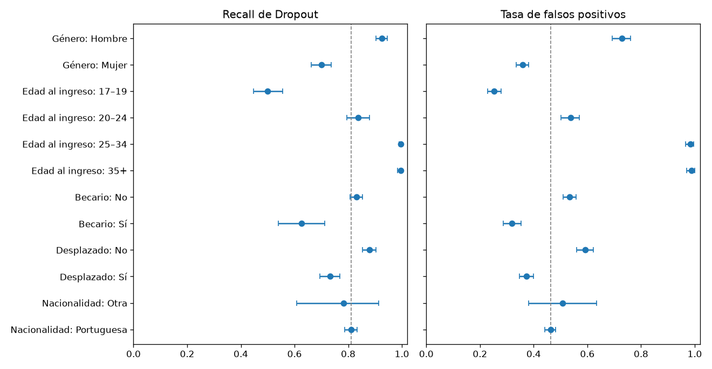
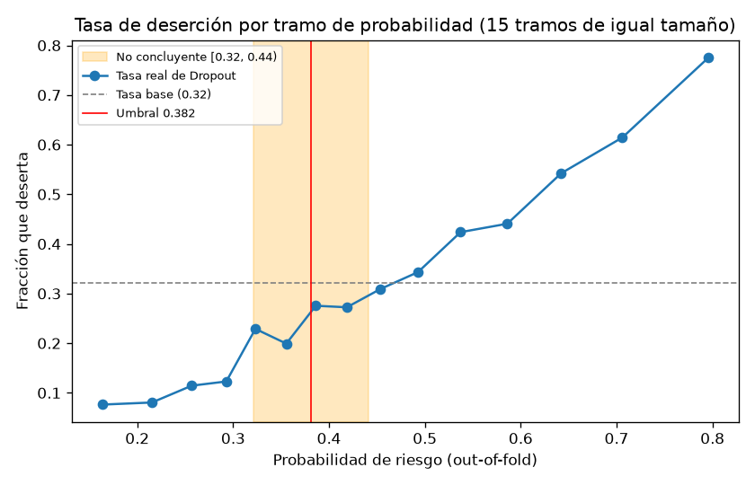

# Análisis de errores y de subgrupos (#14)

Analiza **dónde y con quién se equivoca** el modelo elegido en #13 (Random Forest, umbral 0.382; [decisión 008](../docs/decisiones/008_criterio_seleccion.md)) y fija la zona de abstención y las condiciones de detención y escalamiento ([decisión 009](../docs/decisiones/009_abstencion_y_condiciones.md)).

Se reproduce con:

```bash
uv run python -m src.errores
```

Salidas: `reports/metrics/analisis_errores.json`, `reports/metrics/subgrupos.csv` y las figuras `reports/figures/14_subgrupos.png` y `14_zona_abstencion.png`.

**Datos analizados.** Las 3,539 predicciones out-of-fold de train, con los mismos folds fijos y el mismo umbral de #13: reproducen exactamente su matriz de confusión (TP 921, FN 216, FP 1,114, TN 1,288). **El test no se vuelve a usar** ([decisión 003](../docs/decisiones/003_particion_validacion.md)): ya se evaluó una vez, y las condiciones de uso que se fijan aquí no deben ajustarse mirándolo. Además, en train los subgrupos son 4 veces más grandes, lo que da intervalos más estrechos. Todos los intervalos son bootstrap al 95 % (2,000 remuestreos).

## 1. Perfil de los errores

Media de cada variable en cada celda de la matriz de confusión (en las binarias, proporción). Comparar FN con TP dice qué desertores se le escapan al modelo; FP con TN, a qué no desertores marca.

| Variable | FN (desertor no detectado) | TP (desertor detectado) | FP (falsa alarma) | TN (no desertor no marcado) |
|---|---|---|---|---|
| n | 216 | 921 | 1,114 | 1,288 |
| Edad al ingreso (media) | **19.2** | 27.7 | 25.2 | 19.0 |
| Hombre | **19 %** | 56 % | 45 % | 14 % |
| Nota de admisión | 129.0 | 123.8 | 125.7 | 129.7 |
| Nota de la titulación previa | 135.3 | 130.1 | 130.3 | 136.2 |
| Becario* | 20 % | 8 % | 22 % | 41 % |
| Desplazado | 66 % | 42 % | 47 % | 69 % |
| Horario diurno | 99 % | 82 % | 82 % | 99 % |
| Deudor* | 22 % | 22 % | 7 % | 4 % |
| Matrícula al día* | **75 %** | 66 % | 97 % | 98 % |

\* No entran al modelo principal (decisión 001); sirven para describir a quién afecta el error.

- **Falsos negativos (el error más costoso).** El desertor que el modelo no detecta tiene el perfil del estudiante que no deserta: mujer (81 %), de 19 años, en horario diurno, con buenas notas y desplazada. Es casi indistinguible de los TN en todas las variables del modelo. Lo que sí lo distingue está **fuera** del modelo: el 25 % de los FN no tiene la matrícula al día y el 22 % es deudor, frente al 2 % y el 4 % de los TN.
- **Falsos positivos (coste bajo: un acompañamiento innecesario).** Se parecen a los desertores detectados: mayores (25 años de media), más hombres, más estudiantes de horario nocturno y notas algo más bajas. Pero pagan sus estudios al día (97 %) y casi no tienen deudas (7 %), igual que los TN.

## 2. Métricas por subgrupo

`International` coincide exactamente con nacionalidad extranjera en estos datos (decisión 004), así que se reporta solo una vez como "Nacionalidad: Otra". Becario es la variable `Scholarship holder`, que no entra al modelo principal.

| Subgrupo | n | Desertores (tasa) | Marcados | Recall Dropout [IC 95 %] | Tasa FP [IC 95 %] | Precisión | Desertores entre los no marcados |
|---|---|---|---|---|---|---|---|
| **Global** | 3,539 | 1,137 (32 %) | 58 % | 0.81 | 0.46 | 0.45 | 14 % |
| Hombre | 1,241 | 556 (45 %) | 82 % | 0.92 [0.90, 0.95] | 0.73 [0.69, 0.76] | 0.51 | 18 % |
| Mujer | 2,298 | 581 (25 %) | 44 % | **0.70** [0.66, 0.74] | 0.36 [0.34, 0.38] | 0.40 | 14 % |
| Edad 17–19 | 1,579 | 327 (21 %) | 30 % | **0.50** [0.44, 0.55] | 0.25 [0.23, 0.28] | 0.34 | 15 % |
| Edad 20–24 | 1,056 | 308 (29 %) | 63 % | 0.84 [0.80, 0.88] | 0.54 [0.50, 0.57] | 0.39 | 13 % |
| Edad 25–34 | 546 | 310 (57 %) | **99 %** | 1.00 [0.99, 1.00] | **0.98** [0.97, 1.00] | 0.57 | 20 % |
| Edad 35+ | 358 | 192 (54 %) | **99 %** | 0.99 [0.98, 1.00] | **0.99** [0.97, 1.00] | 0.54 | 33 % |
| Becario: No | 2,645 | 1,022 (39 %) | 65 % | 0.83 [0.81, 0.85] | 0.53 [0.51, 0.56] | 0.50 | 19 % |
| Becario: Sí | 894 | 115 (13 %) | 36 % | **0.63** [0.54, 0.71] | 0.32 [0.29, 0.35] | 0.23 | 7 % |
| Desplazado: No | 1,597 | 603 (38 %) | 70 % | 0.88 [0.85, 0.90] | 0.59 [0.56, 0.62] | 0.47 | 15 % |
| Desplazado: Sí | 1,942 | 534 (27 %) | 47 % | **0.73** [0.69, 0.77] | 0.37 [0.35, 0.40] | 0.43 | 14 % |
| Nacionalidad portuguesa | 3,453 | 1,114 (32 %) | 57 % | 0.81 [0.79, 0.83] | 0.46 [0.44, 0.48] | 0.45 | 14 % |
| Nacionalidad: Otra | 86 | 23 (27 %) | 58 % | 0.78 [0.61, 0.96] | 0.51 [0.38, 0.63] | 0.36 | 14 % |

En los grupos de 25 años o más, los pocos no marcados (6 y 3 estudiantes) hacen que la última columna no sea interpretable.



## 3. Brechas entre subgrupos

Diferencia de cada nivel contra el más numeroso de su variable, con bootstrap independiente dentro de cada grupo. Es **relevante** si supera 0.10 en valor absoluto y su intervalo no contiene 0 (decisión 009).

| Comparación | Brecha de recall [IC 95 %] | Brecha de tasa FP [IC 95 %] | ¿Relevante? |
|---|---|---|---|
| Hombre − Mujer | +0.22 [+0.18, +0.27] | +0.37 [+0.33, +0.41] | Sí |
| Edad 20–24 − 17–19 | +0.34 [+0.27, +0.41] | +0.29 [+0.24, +0.33] | Sí |
| Edad 25–34 − 17–19 | +0.50 [+0.44, +0.56] | +0.73 [+0.70, +0.76] | Sí |
| Edad 35+ − 17–19 | +0.50 [+0.44, +0.55] | +0.74 [+0.71, +0.76] | Sí |
| Becario Sí − No | −0.20 [−0.30, −0.12] | −0.22 [−0.26, −0.17] | Sí |
| Desplazado No − Sí | +0.15 [+0.10, +0.19] | +0.22 [+0.18, +0.26] | Sí |
| Nacionalidad Otra − Portuguesa | −0.03 [−0.21, +0.14] | +0.05 [−0.07, +0.17] | No (y solo 23 desertores) |

Todas las brechas van en la misma dirección: **el modelo detecta mejor a los desertores de los grupos donde la deserción es más frecuente, a costa de marcar también a casi todos sus no desertores**. Recall y tasa de falsos positivos suben juntos, así que no hay un grupo "mejor tratado" en todo: los hombres y los mayores reciben más acompañamiento innecesario, y las mujeres, los jóvenes, los becarios y los desplazados pierden más desertores.

La tasa de desertores entre los no marcados (última columna de la sección 2) es parecida en todos los grupos (13–18 %, salvo los becarios con 7 %): cuando el modelo **no** marca a alguien, se equivoca más o menos igual sea quien sea. La brecha está en cuántos desertores de cada grupo llegan a ser marcados, es decir, en la igualdad de oportunidades de recibir acompañamiento.

## 4. Hallazgos

1. **El modelo es, en la práctica, un filtro por edad.** Marca al 99 % de quienes ingresan con 25 años o más (detecta a todos sus desertores, pero también al 98–99 % de sus no desertores) y solo al 30 % de los de 17–19, donde **deja sin detectar a la mitad de los desertores** (164 de 327, el 76 % de todos los FN). Dentro de los mayores, la marca no ordena a nadie; dentro de los jóvenes, pierde a uno de cada dos.
2. **Las mujeres desertoras se detectan peor.** Recall 0.70 frente a 0.92 en hombres (brecha 0.22, IC [0.18, 0.27]). La causa es que el modelo aprende la tasa base más alta de los hombres (45 % frente a 25 %), que en parte refleja otras diferencias (la V de Cramér entre curso y género es 0.42, auditoría de datos). Quitar `Gender` del modelo **reduce la brecha a la mitad** (0.22 → 0.11) sin una pérdida de recall global distinguible del ruido (sección 7).
3. **Los desertores que se escapan tienen señales financieras que el modelo no ve.** El 25 % de los FN no tiene la matrícula al día y el 22 % es deudor, frente al 2 % y el 4 % de los TN. Esas variables están fuera del modelo principal porque su momento de medición no está documentado (decisión 001), pero la persona que revisa el caso sí puede consultarlas. También los becarios desertores se detectan peor (recall 0.63).
4. **Las falsas alarmas se concentran en estudiantes mayores, hombres y de horario nocturno** que pagan al día. Su coste es bajo (una entrevista), pero en esos grupos la marca no aporta información y puede estigmatizar si se comunica como "riesgo".
5. **Nacionalidad extranjera:** sin diferencias detectables, pero con 86 estudiantes y 23 desertores no hay evidencia para afirmar que el modelo funcione igual en ese grupo.

## 5. Zona de abstención



La probabilidad del Random Forest no está calibrada (se entrenó con `class_weight="balanced"`), así que se interpreta por tramos. Alrededor del umbral, entre 0.32 y 0.44, la fracción real de desertores es del 20–31 %: **igual o menor que la tasa base (32 %)**. Ahí el modelo no aporta información sobre el estudiante. Se define la zona de abstención como **umbral ± 0.06 = [0.32, 0.44)**:

| Resultado reportado | Probabilidad | Estudiantes | Desertores (% de todos los desertores) | Tasa de deserción | Error al umbral 0.382 |
|---|---|---|---|---|---|
| Riesgo | ≥ 0.44 | 1,616 (46 %) | 799 (70 %) | 49 % | 51 % (falsas alarmas) |
| **No concluyente: revisión humana** | 0.32–0.44 | **869 (25 %)** | 222 (20 %) | 26 % | 46 % |
| Sin riesgo | < 0.32 | 1,054 (30 %) | 116 (10 %) | 11 % | 11 % (desertores perdidos) |

- Uno de cada cuatro estudiantes cae en la zona. Allí el modelo, con el umbral único, se equivoca en el 46 % de los casos, frente al 35 % fuera de ella.
- Con la zona, los desertores que el modelo descarta como "sin riesgo" bajan de 216 (19 %) a **116 (10 %)**: los otros 100 se escalan a revisión humana en vez de perderse.
- El coste es revisar 869 casos más sin una recomendación del modelo. El ancho 0.06 es un compromiso: con ±0.04 entrarían 599 casos y se perderían 149 desertores; con ±0.08, 1,161 casos y 87 desertores.

## 6. Condiciones de detención, abstención y escalamiento

Insumo para la demo (#17), que debe aplicarlas en este orden con las funciones de `src/errores.py`, y para la pregunta de defensa. La [decisión 009](../docs/decisiones/009_abstencion_y_condiciones.md) las justifica.

| # | Condición | Cómo se detecta | Acción |
|---|---|---|---|
| 1 | Aplicación a otra institución, país, cohorte o plan de estudios | Origen de los datos | **Detener.** No usar sin reentrenar y validar con datos de esa población |
| 2 | Uso para sancionar, excluir, decidir admisiones o becas | Propósito declarado | **Detener.** Fuera del alcance del proyecto ([proyecto.md](../docs/proyecto.md)) |
| 3 | Entrada fuera del contrato: numérica fuera del rango de train, categoría desconocida o con menos de 10 casos en train, valor faltante | `input_ranges(X_train)` y `out_of_range(X, ranges)` | **Abstenerse:** "perfil fuera de los datos de entrenamiento", revisión humana |
| 4 | Probabilidad en [0.32, 0.44) | `decide(proba, umbral)` | **Escalar:** "no concluyente, requiere revisión humana" |
| 5 | "Sin riesgo" para una mujer, alguien de 17–19 años, becario o desplazado | `restricciones(...)` | **Escalar:** en estos grupos el recall es relevantemente menor; "sin riesgo" no basta para descartar. La revisión debe mirar matrícula y deudas |
| 6 | "Riesgo" para alguien de 25 años o más | `restricciones(...)` | **No usar la marca para priorizar** dentro del grupo (marca al 99 %); comunicarla como "grupo con deserción alta", no como juicio individual |
| 7 | Subgrupo con menos de 30 desertores en train (hoy: nacionalidad extranjera) | `restricciones(...)` | **Tratar como no concluyente:** no hay evidencia del desempeño |
| 8 | Brecha de recall > 0.10 con IC sin 0 al reevaluar en una cohorte nueva, o recall global < 0.70 | Reevaluación periódica con `uv run python -m src.errores` | **Detener** el uso para ese subgrupo (o en general) hasta reentrenar y documentar una decisión nueva |

En la evaluación del perfil fuera de contrato (condición 3), 222 estudiantes de train (6 %) tienen al menos una categoría con menos de 10 casos, sobre todo ocupaciones y titulaciones de los padres. Su error es apenas mayor (40 % frente a 37 %), así que la condición es preventiva: protege frente a perfiles nuevos, más que corregir un error observado. Los rangos numéricos de train coinciden con los de la auditoría (edad 17–70, notas 95–190).

## 7. ¿Excluir las variables sensibles?

Se repitió la validación cruzada del Random Forest con los mismos hiperparámetros y folds, volviendo constantes las variables excluidas, y se eligió el umbral con el mismo criterio (decisión 008):

| Variante | Umbral | F1-macro | Recall Dropout | Δ recall vs. completo [IC 95 %] | Brecha de recall mujer − hombre [IC 95 %] | Brecha de tasa FP mujer − hombre |
|---|---|---|---|---|---|---|
| Completo (elegido en #13) | 0.382 | 0.620 | 0.810 | — | −0.22 [−0.27, −0.18] | −0.37 |
| Sin `Gender` | 0.388 | 0.621 | 0.799 | −0.011 [−0.026, +0.004] (ruido) | **−0.11** [−0.15, −0.06] | −0.18 |
| Sin `Gender` ni edad | 0.404 | 0.624 | 0.783 | −0.027 [−0.044, −0.010] (real) | −0.11 [−0.16, −0.06] | −0.17 |

- **Sin `Gender`, la brecha de género se reduce a la mitad sin una pérdida de recall distinguible del ruido.** La otra mitad persiste porque otras variables (curso, edad, horario) llevan parte de la misma información.
- Quitar también la edad cuesta recall real y no reduce más la brecha de género. La edad es la señal más fuerte del modelo y su efecto es en parte legítimo (los estudiantes mayores compaginan estudio y trabajo), así que se mantiene, con las condiciones 5 y 6.
- **Recomendación para el equipo:** adoptar el modelo sin `Gender` requiere una decisión nueva que reemplace a la 008, porque el test ya se usó con el modelo completo. Se deja como propuesta para discutir antes de la demo (#17), no como cambio de este issue.

## 8. Limitaciones éticas

Insumo para la sección de uso responsable del informe (#18).

1. **Proxies de grupo, no de la persona.** Con la información disponible al ingreso, el modelo distingue sobre todo por edad y género. Su marca dice "pertenece a un grupo donde se deserta más", no "esta persona va a desertar". Nunca debe comunicarse al estudiante como un pronóstico individual.
2. **Igualdad de oportunidades desigual.** Mujeres, jóvenes de 17–19 años, becarios y desplazados que desertan tienen menos probabilidad de recibir acompañamiento. Las condiciones 5 y 6 lo mitigan con revisión humana, pero no lo eliminan. Las brechas son estadísticas del dataset y pueden reflejar desigualdades estructurales que el modelo reproduce.
3. **Variables sensibles en el modelo.** `Gender`, `Age at enrollment`, `Marital Status`, `Nacionality`, `Displaced` y `Educational special needs` entran al modelo. Usarlas para acompañar (beneficio) es distinto que para restringir (perjuicio). Cualquier uso que pueda perjudicar está prohibido (condición 2), y la sección 7 muestra que `Gender` puede retirarse con bajo coste.
4. **Grupos pequeños sin evaluación.** Estudiantes extranjeros (86), con necesidades educativas especiales (51 en todo el dataset) y otras minorías no tienen evidencia suficiente. Que no aparezca una brecha no significa que no exista.
5. **Una institución, un país, sin fechas.** Los datos son de una sola institución portuguesa, sin año de cohorte (auditoría de datos). Las brechas pueden cambiar en otras poblaciones o con el tiempo (condiciones 1 y 8).
6. **Estigmatización y profecía autocumplida.** Un estudiante etiquetado como "en riesgo" puede ser tratado de otro modo. El resultado se comunica a la coordinación como prioridad de contacto, con la opción "no concluyente", y el acompañamiento debe ser voluntario y no dejar constancia negativa en el expediente.
7. **Análisis con train, no con test.** Las cifras de este informe son out-of-fold en train. Dentro de su intervalo, coinciden con los resultados globales en test (#13), pero los subgrupos no se verificaron en test para no reutilizarlo.
