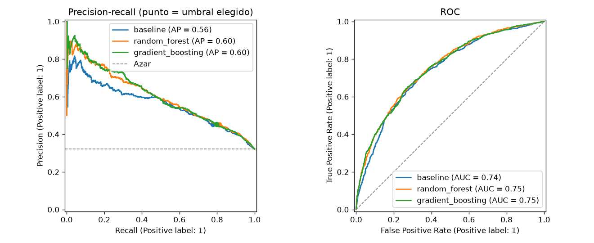
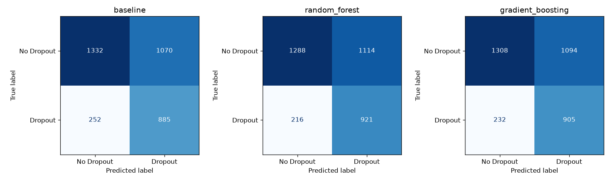
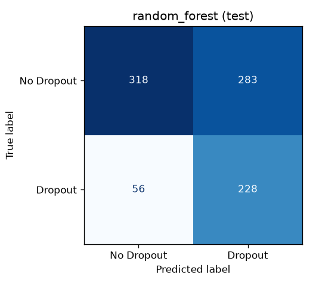

# Comparación de modelos y selección final (#13)

Compara el baseline (#9, regresión logística) con los dos candidatos (#11, Random Forest; #12, Gradient Boosting) y elige el modelo final con el criterio de la [decisión 008](../docs/decisiones/008_criterio_seleccion.md), fijado y versionado antes de usar el test.

Se reproduce con:

```bash
uv run python -m src.comparacion          # CV, umbral y selección (solo train)
uv run python -m src.comparacion --test   # evaluación final en test: ya ejecutada, no se repite
```

Salidas: `reports/metrics/comparacion_cv.json` y `comparacion_cv.md` (tablas), `reports/metrics/test_final.json`, y las figuras `reports/figures/13_pr_roc_cv.png`, `13_confusion_cv.png` y `13_confusion_test.png`.

## 1. Criterio de selección (fijado antes de ver test)

1. Cada modelo usa el umbral de **mayor recall de Dropout con F1-macro ≥ 0.62**, elegido con sus probabilidades out-of-fold de train.
2. Son elegibles los modelos que alcanzan el piso, y gana el de mayor recall de Dropout.
3. Si el intervalo bootstrap pareado al 95 % de la diferencia de recall contiene 0, es un empate, y gana el más simple (baseline < Random Forest < Gradient Boosting).
4. El modelo elegido se evalúa **una sola vez** en test.

El commit del criterio (`docs: criterio de seleccion y umbral de decision antes de test #13`) es anterior al de los resultados de test en el historial de la rama.

## 2. Tabla comparativa (validación cruzada, 5 folds, media ± desviación)

Al umbral ajustado; el umbral de cada fold se elige con los otros cuatro, así que estas cifras no están infladas. Los tiempos son por fold y salen de `reports/metrics/<modelo>.json`. Todos los resultados se regeneraron el 2026-10-20 en un único equipo de referencia (AMD Ryzen 5 5600X, 12 hilos, 31.9 GB de RAM, sin GPU), así que los tiempos de los tres modelos son comparables entre sí:

| Modelo | Umbral | F1-macro | Recall Dropout | Precisión Dropout | Balanced acc. | Entrenamiento (s) | Inferencia (ms/1,000) | Emisiones del entrenamiento completo (gCO2eq) |
|---|---|---|---|---|---|---|---|---|
| Baseline | 0.431 ± 0.005 | 0.620 ± 0.023 | 0.773 ± 0.014 | 0.453 ± 0.021 | 0.665 ± 0.016 | 0.03 ± 0.00 | 12.4 ± 1.8 | 0.043 |
| **Random Forest** | 0.382 ± 0.007 | 0.620 ± 0.021 | **0.808 ± 0.021** | 0.454 ± 0.018 | 0.673 ± 0.014 | 0.47 ± 0.01 | 94.2 ± 3.1 | 0.876 |
| Gradient Boosting | 0.385 ± 0.007 | 0.618 ± 0.023 | 0.792 ± 0.012 | 0.452 ± 0.020 | 0.668 ± 0.017 | 0.36 ± 0.05 | 17.6 ± 1.2 | 0.595 |

Coste de la búsqueda de hiperparámetros (una vez, no por fold): Random Forest 61 s y Gradient Boosting 43 s (25 combinaciones × 5 folds, decisión 006); el baseline ajusta un solo hiperparámetro, `C`, en menos de 1 s por valor. Las emisiones (gCO2eq) son las del entrenamiento completo de cada modelo, incluida la búsqueda de hiperparámetros, medidas con codecarbon en #15; el detalle (energía, inferencia, tamaño y hardware) está en [green_ai.md](green_ai.md).

Al umbral 0.5, como referencia (los valores de #9, #11 y #12):

| Modelo | F1-macro | Recall Dropout | Precisión Dropout | Balanced acc. |
|---|---|---|---|---|
| Baseline | 0.670 ± 0.018 | 0.631 ± 0.031 | 0.527 ± 0.030 | 0.681 ± 0.015 |
| Random Forest | 0.676 ± 0.016 | 0.602 ± 0.018 | 0.545 ± 0.029 | 0.681 ± 0.014 |
| Gradient Boosting | 0.674 ± 0.006 | 0.653 ± 0.015 | 0.526 ± 0.012 | 0.687 ± 0.004 |

`comparacion_cv.md` incluye además los tiempos medidos durante la comparación, en el mismo equipo. Difieren poco de los de esta tabla porque son otra ejecución.

## 3. ¿Diferencias reales o ruido?

Bootstrap pareado (2,000 remuestreos) sobre las 3,539 predicciones out-of-fold, al umbral ajustado de cada modelo:

| Comparación | Métrica | Diferencia | IC 95 % | Lectura |
|---|---|---|---|---|
| Random Forest − Baseline | Recall Dropout | +0.032 | [+0.014, +0.051] | **Real** |
| Random Forest − Baseline | F1-macro | −0.000 | [−0.011, +0.011] | Igual |
| Gradient Boosting − Baseline | Recall Dropout | +0.018 | [−0.001, +0.037] | Ruido (por poco) |
| Gradient Boosting − Baseline | F1-macro | +0.000 | [−0.012, +0.013] | Igual |
| Random Forest − Gradient Boosting | Recall Dropout | +0.014 | [−0.001, +0.030] | Ruido |

Con el mismo piso de F1-macro, el Random Forest detecta unos 3 desertores más por cada 100 que el baseline, y la diferencia no es ruido. Frente al Gradient Boosting, la ventaja no se distingue del ruido.

## 4. Ajuste del umbral



Los tres modelos tienen curvas casi superpuestas (AUC-ROC 0.74–0.75, precisión media 0.56–0.60). Los árboles solo se separan del baseline en la zona de recall bajo, que no interesa aquí. Bajar el umbral de 0.5 a ≈ 0.38 sube el recall del Random Forest de 0.60 a 0.81 a cambio de bajar la precisión de 0.55 a 0.45 y el F1-macro de 0.68 a 0.62: se detectan 4 de cada 5 desertores y algo menos de 1 de cada 2 marcados lo es. Con revisión humana y una intervención de bajo coste (tutoría o entrevista), es el compromiso que fija la decisión 008.

## 5. Matrices de confusión (out-of-fold, umbral ajustado)



| Modelo | Desertores detectados (TP) | Desertores no detectados (FN) | Falsas alarmas (FP) | No desertores bien clasificados (TN) |
|---|---|---|---|---|
| Baseline | 885 | 252 | 1,070 | 1,332 |
| Random Forest | 921 | 216 | 1,114 | 1,288 |
| Gradient Boosting | 905 | 232 | 1,094 | 1,308 |

El Random Forest recupera 36 desertores más que el baseline a cambio de 44 falsas alarmas más.

## 6. Selección

- Elegibles (F1-macro out-of-fold ≥ 0.62): los tres.
- Mayor recall de Dropout: Random Forest (0.810 out-of-fold).
- Empatado con él (IC de la diferencia contiene 0): Gradient Boosting.
- Desempate por simplicidad entre Random Forest y Gradient Boosting: **Random Forest**, umbral **0.382**.

## 7. Evaluación final en test (una sola vez)

Random Forest entrenado con todo train (3,539 filas), umbral 0.382, sobre las 885 filas de test. Intervalos bootstrap al 95 %:

| Métrica | Test | IC 95 % | CV (out-of-fold) |
|---|---|---|---|
| F1-macro | 0.613 | [0.579, 0.644] | 0.620 |
| Recall Dropout | 0.803 | [0.755, 0.848] | 0.810 |
| Precisión Dropout | 0.446 | [0.402, 0.488] | 0.453 |
| Balanced accuracy | 0.666 | [0.633, 0.695] | 0.673 |



De los 284 desertores de test, el modelo detecta 228 y deja sin detectar 56. Marca a 511 estudiantes, de los que 283 no desertan. Los resultados en test coinciden con los de CV dentro de su intervalo, así que no hay señales de sobreajuste al elegir umbral e hiperparámetros. El F1-macro en test (0.613) queda algo por debajo del piso de 0.62, pero su intervalo lo contiene: es la variación esperable en 885 filas, no un incumplimiento del criterio, que se aplica en CV.

## 8. Conclusión

Se elige el **Random Forest (#11) con umbral 0.382**. Con la misma calidad global que los otros dos (F1-macro ≈ 0.62), es el que más desertores detecta: 4 de cada 5 en CV y en test, con una mejora sobre el baseline que no es ruido. El Gradient Boosting queda empatado en recall, y el criterio fijado de antemano prefiere el Random Forest por ser el más simple de los dos. El baseline pierde por recall pese a ser el más barato e interpretable.

Limitaciones: la señal disponible al ingreso es moderada (AUC ≈ 0.75), así que más de la mitad de los estudiantes marcados no desertarían, y la lista sirve para priorizar el acompañamiento, no para decidir sobre una persona sin revisión humana. La energía y las emisiones de cada modelo están medidas en [green_ai.md](green_ai.md) (#15), y el análisis de errores por subgrupos, en especial por género, que es la tercera variable más importante, en [analisis_errores.md](analisis_errores.md) (#14).

Limitaciones del criterio, señaladas en la revisión del PR #37:

- **Desempate por simplicidad.** La decisión 008 ordena los modelos de más simple a más complejo (baseline < Random Forest < Gradient Boosting) y justifica ese orden en parte por el coste. En nuestras cifras, sin embargo, el Gradient Boosting es más barato que el Random Forest en inferencia (18 vs 94 ms por 1,000 registros), entrenamiento (0.36 vs 0.47 s por fold) y búsqueda de hiperparámetros (43 vs 61 s). La elección se mantiene porque el criterio se fijó antes de usar test y cambiarlo después lo invalidaría, pero el Gradient Boosting es una alternativa equivalente en recall y más eficiente.
- **Umbral sin validación anidada.** El umbral final de cada modelo se elige y se evalúa sobre las mismas predicciones out-of-fold; por eso los tres quedan justo en F1-macro ≈ 0.620. Afecta a los tres por igual, así que no cambia la comparación; la tabla de la sección 2, en cambio, elige el umbral de cada fold sin ese fold.
