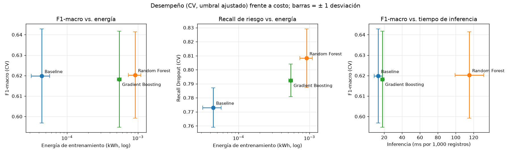

# Medición Green AI: costo computacional y energético (#15)

Mide el costo de entrenar y usar el baseline (#9, regresión logística), el Random Forest (#11) y el Gradient Boosting (#12), y lo pone frente a su desempeño para decidir si la mejora de los modelos complejos justifica su costo. Método en la [decisión 011](../docs/decisiones/011_medicion_green_ai.md).

Se reproduce con:

```bash
uv run python -m src.green_ai     # ~15 min: 3 repeticiones del entrenamiento de los tres modelos
uv run python -m src.comparacion  # vuelve a generar la tabla de #13 con energía y emisiones (solo CV)
```

Salidas: `reports/metrics/green_ai.json` (todas las mediciones), `reports/metrics/green_ai.md` (tablas), `reports/figures/15_desempeno_vs_costo.png`, y `energia_kwh` y `emisiones_gco2eq` en `reports/metrics/<modelo>.json`.

## 1. Qué se mide y cómo

| Medida | Definición |
|---|---|
| Tiempo de entrenamiento | Ajuste de `C` (baseline, 11 valores × 5 folds) o búsqueda aleatoria (candidatos, 25 combinaciones × 5 folds) **más** el entrenamiento final con todo train (3,539 filas). No incluye la permutation importance. |
| Energía (kWh) y emisiones (gCO2eq) | `codecarbon.OfflineEmissionsTracker` durante el entrenamiento, con la intensidad de carbono de la red de República Dominicana (580.78 gCO2/kWh, datos de codecarbon). |
| Inferencia | `predict_proba` del pipeline completo sobre 200 lotes de 1,000 filas de train; tiempo (ms) y energía por cada 1,000 registros. |
| Tamaño | Pipeline (preprocesamiento + modelo) serializado con `joblib`, en MB. |

Para que las tres mediciones sean comparables, se toman en el mismo equipo, en un único proceso, con 3 repeticiones y alternando los modelos en cada repetición (baseline, RF, GB, baseline, ...). Se reporta media ± desviación entre repeticiones. Nunca se usa test.

## 2. Equipo

| Componente | Valor |
|---|---|
| CPU | Intel Core i5-6300U @ 2.40 GHz (2 núcleos, 4 hilos) |
| RAM | 7.9 GB |
| GPU | Ninguna |
| Sistema | Windows 11 (10.0.22000) |
| Software | Python 3.12, scikit-learn 1.9.1, codecarbon 3.3.1 (modo `process`) |

El equipo no expone un medidor de potencia por hardware a Python en Windows, así que codecarbon **estima** la potencia de la CPU a partir de su TDP y de la carga del proceso, y la de la RAM a partir de su tamaño. Los valores absolutos son aproximados; las proporciones entre modelos son más fiables porque los tres se estiman igual.

## 3. Resultados

Entrenamiento (búsqueda o ajuste + modelo final) y uso, media de las repeticiones:

| Modelo | Tiempo entrenamiento (s) | Energía (kWh) | Emisiones (gCO2eq) | Inferencia (ms/1,000) | Tamaño (MB) | F1-macro (CV) | Recall Dropout (CV) |
|---|---|---|---|---|---|---|---|
| Baseline | 7.5 ± 1.2 | 4.41e-05 | 0.026 | 13.3 | 0.01 | 0.620 ± 0.023 | 0.773 ± 0.014 |
| Random Forest | 141.8 ± 18.4 | 9.15e-04 | 0.532 | 115.2 | 18.58 | 0.620 ± 0.021 | 0.808 ± 0.021 |
| Gradient Boosting | 92.2 ± 6.7 | 5.46e-04 | 0.317 | 17.9 | 0.28 | 0.618 ± 0.023 | 0.792 ± 0.012 |

F1-macro y recall: validación cruzada al umbral ajustado ([comparación, #13](comparacion_modelos.md)). Las desviaciones de las mediciones de costo están en `reports/metrics/green_ai.md`.

Costo relativo al baseline:

| Modelo | Energía de entrenamiento | Tiempo de inferencia | Tamaño |
|---|---|---|---|
| Random Forest | ≈ 21× | ≈ 9× | ≈ 1,700× |
| Gradient Boosting | ≈ 12× | ≈ 1.3× | ≈ 25× |



## 4. Reflexión: ¿la mejora justifica el costo?

**En F1-macro, no hay mejora que pagar.** Los tres modelos quedan en F1-macro ≈ 0.62 con desviaciones de ≈ 0.02 entre folds, y el bootstrap pareado de #13 no distingue sus diferencias de cero. En la gráfica de la izquierda, el baseline domina: el mismo F1-macro por 12 a 21 veces menos energía.

**En recall de Dropout, que es el criterio de selección (decisión 008), sí hay una mejora real, pero pequeña.** El Random Forest detecta 0.808 de los desertores frente a 0.773 del baseline (+0.032, IC 95 % [+0.014, +0.051]): unos 3 desertores más por cada 100, 36 más en las 3,539 filas de train. A cambio, entrenar cuesta ≈ 21× más energía, predecir ≈ 9× más tiempo y el modelo ocupa ≈ 18.6 MB frente a ≈ 10 KB.

**En valores absolutos, el costo es despreciable.** Entrenar el Random Forest, con su búsqueda completa, consume ≈ 0.0009 kWh y emite ≈ 0.5 g CO2eq: lo mismo que una bombilla LED de 10 W encendida unos 5 minutos y medio. El modelo se reentrenaría a lo sumo una vez por cohorte o semestre, y puntuar a toda una cohorte (≈ 4,400 estudiantes) tarda alrededor de medio segundo. Frente a eso, cada desertor detectado a tiempo puede recibir acompañamiento. Para este problema, por tanto, el costo ambiental no es un motivo para renunciar a la mejora de recall.

**Pero el Random Forest no es el modelo eficiente.** El Gradient Boosting obtiene la mayor parte de la mejora de recall (+0.018 frente al baseline; su diferencia con el Random Forest, +0.014, es ruido) con ≈ 60 % de la energía de entrenamiento, ≈ 6× menos tiempo de inferencia y un modelo ≈ 66× más pequeño. Esto confirma la limitación señalada en la revisión del PR #37: el orden "baseline < Random Forest < Gradient Boosting" de la decisión 008 no refleja el costo real. El criterio se fijó antes de usar test y no se cambia, pero queda documentado.

## 5. Conclusión: trade-off desempeño / eficiencia

- **Baseline:** el más eficiente con mucha diferencia y con el mismo F1-macro. Es la opción si los recursos son muy limitados o si se prioriza la interpretabilidad.
- **Random Forest (elegido en #13):** el mejor recall de Dropout, con una mejora real sobre el baseline, al mayor costo de los tres. La mejora **justifica** su costo porque este es despreciable en valores absolutos (< 1 g CO2eq por entrenamiento) y el beneficio (≈ 3 desertores más detectados por cada 100) es el objetivo del proyecto.
- **Gradient Boosting:** la alternativa equivalente en recall y más eficiente; está en la frontera desempeño-costo y sería la elección si el costo fuera un criterio de selección explícito o si el modelo se desplegara en un entorno con recursos limitados.

Ningún modelo supera al baseline en F1-macro; la complejidad solo se paga con recall de la clase de riesgo.

## 6. Limitaciones

- La energía es una estimación de codecarbon (TDP y carga), no una medición con vatímetro; sirve para comparar los modelos entre sí más que como valor absoluto.
- La intensidad de carbono es el promedio anual del país (datos de 2022 en codecarbon), no la de la hora de ejecución.
- Las mediciones son de un único portátil; en otro equipo cambian los valores absolutos, no el orden entre modelos.
- El tiempo de búsqueda depende del paralelismo: el Random Forest usa `n_jobs=-1`, el Gradient Boosting paraleliza con OpenMP y la regresión logística usa un solo hilo, como en sus scripts de #9, #11 y #12. Se mide cada modelo tal como se entrena en el proyecto.
